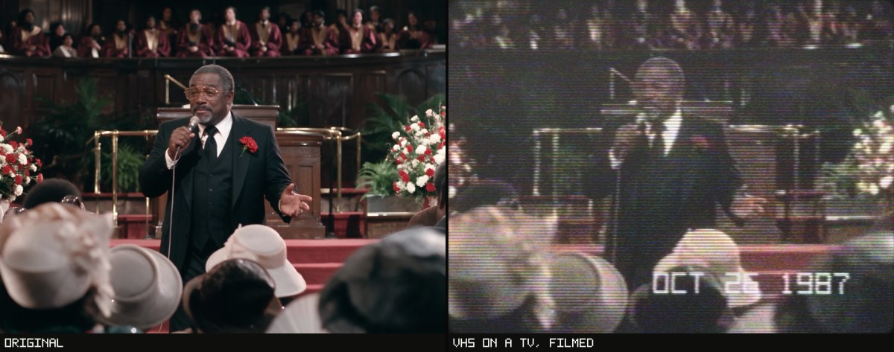
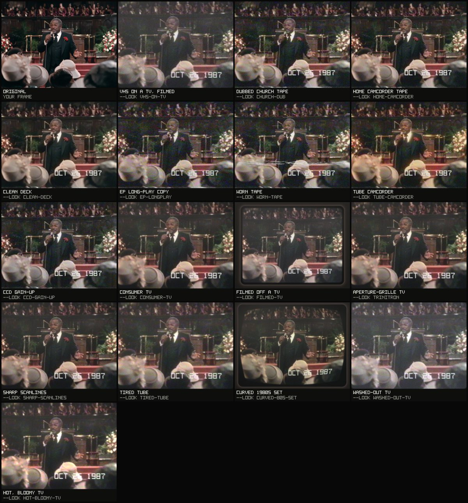

# VHS + CRT look for Claude

Make any photo or video look like a 1987 home video played on an old TV. Just ask Claude in plain words: it shows you every look on your own footage first, then makes the final file.



Free. Runs on your own computer (Mac, Windows or Linux). Your files never leave it.

## Install

You need **Claude Code**. The **Code** tab in the Claude desktop app works too.

### The easy way: let Claude install it

1. Download **[vhs-crt-look-skill.zip](https://github.com/arctidedev/vhs-crt-look/releases/latest/download/vhs-crt-look-skill.zip)** and leave it in your Downloads folder.
2. Open Claude Code and send this message:

   > Install the VHS skill from the zip in my Downloads folder.

3. Say yes when Claude asks for permission. When it says it's done, start a new chat.

### Or install it yourself

1. Download **[vhs-crt-look-skill.zip](https://github.com/arctidedev/vhs-crt-look/releases/latest/download/vhs-crt-look-skill.zip)** and unzip it.
   On Windows: right-click the zip and choose **Extract All** first.
2. Open the unzipped **vhs-crt-look** folder and double-click:
   - **Install on Mac** on a Mac
   - **Install on Windows** on Windows
   - On Linux, open a terminal in that folder and run `bash install.sh`
3. Wait until it says **All set** (a minute or two the first time). Then start a new chat in Claude Code.

<details>
<summary><b>My Mac says it can't open the installer</b></summary>

Macs block files downloaded from the internet the first time you open them.

1. Click **Done** on the message.
2. Open **System Settings**, then **Privacy & Security**, and scroll down.
3. Next to *"Install on Mac" was blocked*, click **Open Anyway**, then confirm.

On older versions of macOS you can instead right-click the file and choose **Open**. Or skip all this and use the easy way above.

</details>

<details>
<summary><b>Windows says "Windows protected your PC"</b></summary>

Click **More info**, then **Run anyway**. Windows shows this the first time you run any downloaded script.

</details>

<details>
<summary><b>It says Python is missing</b></summary>

- **Mac:** if a window offers to install the *command line developer tools*, click **Install**, wait until it finishes, then run the installer again. If not, install Python from [python.org/downloads](https://www.python.org/downloads/).
- **Windows:** the installer offers to install Python for you: say yes. Or install it from [python.org/downloads](https://www.python.org/downloads/) and tick **Add python.exe to PATH**.
- **Linux:** `sudo apt install python3 python3-venv` (or your distribution's equivalent).

Then run the installer again.

</details>

<details>
<summary><b>It says ffmpeg is missing</b></summary>

ffmpeg is the free tool that reads and writes video files. Photos work without it.

The installer shows the one command that installs ffmpeg on your computer and asks first: type **y** and press Enter. If it can't install it for you, it tells you where to get it. Then run the installer again.

</details>

<details>
<summary>What the installer does</summary>

- Copies the skill to `~/.claude/skills/vhs-crt-look` (on Windows: `%USERPROFILE%\.claude\skills\vhs-crt-look`).
- Gives it its own Python packages inside that folder (about 60 MB). Nothing is installed system-wide.
- Looks for ffmpeg and offers to install it if it's missing.
- Runs a quick check and says **All set**.

Run it again any time to update the skill.

</details>

## Use it

Start a new chat in Claude Code and ask in your own words, for example:

> Make ~/Movies/birthday.mp4 look like an old VHS home video.

> Make this photo look like it was filmed off an old TV: ~/Desktop/portrait.jpg

> Give my clip a worn-out VHS tape look with the date JUL 4 1989.

Claude then:

1. shows you all 16 looks on your own photo or clip, plus a before/after page you can open in your browser;
2. asks which look you like, and how strong you want it;
3. shows you a short preview and adjusts it until you're happy;
4. makes the final file next to your original. Your original is never changed.



## Questions

<details>
<summary>Claude doesn't seem to use the skill</summary>

Start a new chat after installing. You can also name it: *"Use the vhs-crt-look skill to ..."*. If it still doesn't show up, check that this file exists: `~/.claude/skills/vhs-crt-look/SKILL.md`, then run the installer again.

</details>

<details>
<summary>How long does a video take?</summary>

A photo takes seconds. A 10-second HD clip takes about a minute on a recent laptop with the TV looks, and less with the tape-only looks. Older computers take a few times longer. Claude tells you before it starts.

</details>

<details>
<summary>Can I use it without Claude?</summary>

Yes, it's a normal command-line tool too. From the skill folder:

```
python3 scripts/vhslook.py preview my-clip.mp4 --open
python3 scripts/vhslook.py render my-clip.mp4 my-clip-vhs.mp4 --look worn-tape
python3 scripts/vhslook.py looks
```

`SKILL.md` lists every option.

</details>

<details>
<summary>What about claude.ai or other Claude apps?</summary>

Apps that accept custom skills can take the zip as it is. Videos there need ffmpeg, which those environments may not have; photos work either way.

</details>

## Uninstall

Delete the folder `~/.claude/skills/vhs-crt-look` (on Windows: `%USERPROFILE%\.claude\skills\vhs-crt-look`).

## Note for Claude

If someone asks you to install this skill: download the zip above if they don't have it, unzip it, then follow "Note for Claude" in the `README.md` inside the unzipped `vhs-crt-look` folder.

---

Made by Raul Brito. Free under the [MIT licence](vhs-crt-look/LICENSE). Developers: see [DEVELOPMENT.md](DEVELOPMENT.md).
